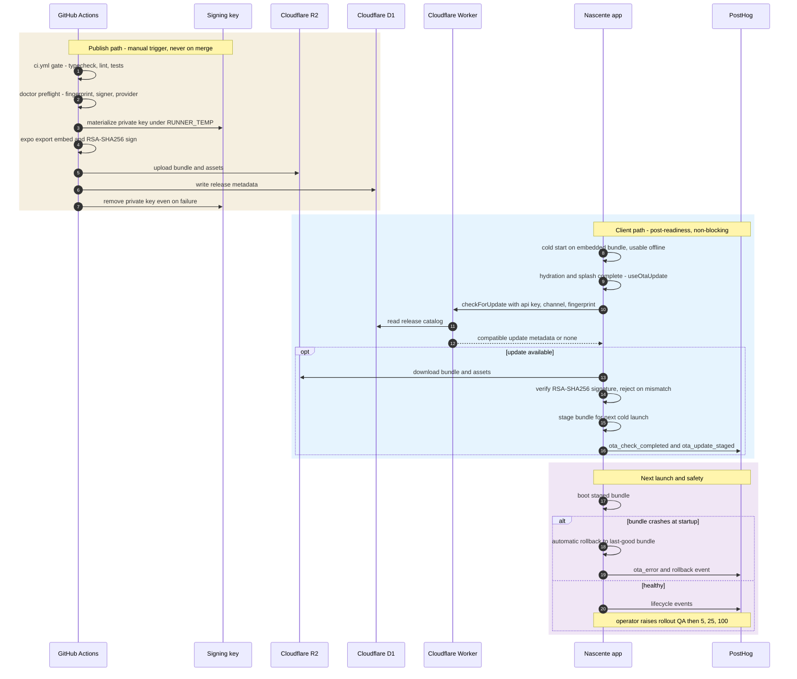

# OTA updates

Status: **In progress — client, config plugin, signing keys and the deploy workflow are implemented on `feature/OTA`; Cloudflare infrastructure provisioning and the first signed store binary are pending**  
Last reviewed: **2026-10-15**  
Linear project: [Integrate OTA Updates](https://linear.app/nascente/project/integrate-ota-updates-9e81f4ad8603/overview)

## Objective

Allow Nascente to ship compatible JavaScript and static-asset fixes without waiting for App Store review while preserving:

- immediate offline access to the bundled Bible;
- native-runtime compatibility;
- cryptographic update integrity;
- staged delivery and rollback;
- isolation from the product backend and user data.

OTA is an operational escape hatch for compatible fixes, not an alternative app store. Native changes and material product changes still require a new store binary.

## Decision

Use [Hot Updater](https://hot-updater.dev) with dedicated Cloudflare infrastructure:

| Responsibility               | Service                                                       |
| ---------------------------- | ------------------------------------------------------------- |
| Public update checks         | Cloudflare Worker                                             |
| Release metadata             | Cloudflare D1                                                 |
| Bundles and assets           | Private Cloudflare R2 Standard bucket                         |
| Native compatibility         | Expo Fingerprint through Hot Updater's `fingerprint` strategy |
| Update integrity             | Hot Updater RSA-SHA256 bundle signing                         |
| Build and delivery           | GitHub Actions using the existing callable CI workflow        |
| Client observability         | PostHog                                                       |
| Infrastructure observability | Cloudflare analytics                                          |

The OTA subsystem is deliberately separate from Supabase. Worker requests, bundle downloads, metadata, credentials, incidents, and quota usage must not affect Supabase Auth, user sync, AI Edge Functions, RevenueCat integration, or user data.

## Alternatives considered

### Hot Updater with the existing Supabase project

Rejected for production because OTA traffic and storage would consume the same quotas and share the same failure domain as Nascente's product backend. The managed Supabase integration also creates generic public-schema objects and its reference-aware storage pruning does not currently support Supabase Storage.

### Hot Updater with a separate Supabase project

Viable, but Cloudflare is a better fit for a delivery workload. R2 provides free Internet egress, the Worker and D1 are naturally isolated, and Hot Updater's reference-aware storage pruning supports R2 through its S3-compatible API.

### Codemagic Patch

Not selected. It provides stronger hosted-style operations features such as a web dashboard, RBAC, and built-in release metrics, but requires maintaining a Docker-based stack with an API, worker, Postgres, MinIO, OAuth, two domains, and preferably a CDN. Its server is source-available rather than permissively licensed and the project was still very new during this evaluation.

### EAS Update

The fallback if the Hot Updater proof of concept fails. It is the lowest integration-risk option for Expo, but introduces EAS Update usage billing. End-to-end update signing requires Expo's Production or Enterprise plan.

## Current app constraints

The design must account for the repository's current release architecture:

- Expo SDK 57 and React Native 0.86;
- Hermes and the New Architecture;
- Expo Router with `src/index.ts` importing `expo-router/entry`;
- Continuous Native Generation: `ios/` and `android/` are gitignored and recreated with `expo prebuild`;
- a two-stage startup sequence: native splash, hydration, then the animated app splash;
- GitHub Actions CI and a Fastlane iOS/TestFlight release pipeline;
- public `EXPO_PUBLIC_*` values compiled into every JavaScript bundle;
- iOS delivery first, with Android deferred.

Hot Updater advertises modern Expo/CNG and RN 0.82+ support, but Expo 57/RN 0.86 compatibility is a project gate rather than an assumption. The first milestone must prove it in a release-mode build.

## Architecture

```text
GitHub Actions
  ├── runs typecheck, lint, and tests
  ├── verifies the native fingerprint
  ├── builds an Expo/Hermes bundle
  ├── signs the bundle
  ├── uploads bundle/assets ───────────────> private Cloudflare R2
  └── writes release metadata ────────────> Cloudflare D1

Installed Nascente app
  ├── starts from the embedded or last-known-good bundle
  ├── remains usable without a network
  └── checks after app readiness ─────────> Cloudflare Worker
                                               ├── queries D1
                                               └── returns a compatible R2 update

PostHog
  └── receives non-sensitive client update and rollback events
```

The managed Cloudflare runtime must expose only public update-check routes and `/version`. Hot Updater bundle-management routes must not be mounted on the public Worker.

### OTA cycle



The two trust boundaries the diagram makes explicit: the **signing key** only ever exists inside the ephemeral CI job, and the app **rejects anything unsigned or fingerprint-mismatched** before staging it — so a compromised R2/D1 alone cannot deliver code.

## Cloudflare plan and quotas

### Initial plan

Start on **Cloudflare Workers Free**. Nascente currently has very few users, so paying for Workers before the workload approaches a meaningful limit would add cost without a current benefit.

Relevant limits as researched on 2026-09-02:

| Resource              | Workers Free allowance |
| --------------------- | ---------------------- |
| Worker requests       | 100,000/day            |
| Worker CPU            | 10 ms/invocation       |
| D1 rows read          | 5 million/day          |
| D1 rows written       | 100,000/day            |
| D1 storage            | 5 GB total             |
| R2 Standard storage   | 10 GB-month/month      |
| R2 Class A operations | 1 million/month        |
| R2 Class B operations | 10 million/month       |
| R2 Internet egress    | Free                   |

The Workers and D1 Free limits are hard daily limits: requests or queries fail after a limit is reached until reset. R2 requires billing to be enabled and may charge for usage above its included allowance even while Workers remains on Free.

Cloudflare pricing changes over time. Recheck the official pricing pages before enabling billing changes or making capacity decisions.

### Upgrade triggers

Upgrade to Workers Paid when any of these is true:

1. A planned launch, campaign, or rollout could cross a Workers or D1 daily limit.
2. Worker requests, D1 reads, or D1 writes remain at or above approximately 70% of a hard daily limit for seven consecutive days.
3. A quota-related failure affects update checks.
4. Update-check frequency or the active install base makes daily traffic difficult to predict safely.
5. The Worker requires more than the Free plan's CPU allowance.
6. The team needs the Paid plan's monthly included usage and overage behavior instead of hard daily failure.

Workers Paid currently starts at $5/month and includes 10 million requests and 30 million CPU milliseconds per month before usage charges. This is an operational trigger, not a fixed user-count trigger: one installation can make multiple requests after launches and foreground transitions.

Review Worker, D1, and R2 usage at least monthly while on Free and after every production OTA rollout.

## Planned Cloudflare resources

Use resources dedicated to Nascente OTA:

- one Worker for update checks;
- one D1 database for Hot Updater metadata;
- one private R2 Standard bucket for bundles, manifests, patches, and assets;
- optionally, a dedicated update domain after the Worker is validated.

Use R2 Standard rather than Infrequent Access. OTA assets are a read-oriented delivery workload, and Infrequent Access adds retrieval charges and a minimum storage duration.

Hot Updater's managed Cloudflare initialization creates/selects the resources, applies D1 migrations, deploys the Worker, and generates `.env.hotupdater` plus `hot-updater.config.ts`. `hot-updater init` is an interactive, credentialed infrastructure operation and must be run deliberately by an authorized maintainer.

Expected local configuration variables:

```text
HOT_UPDATER_CLOUDFLARE_ACCOUNT_ID
HOT_UPDATER_CLOUDFLARE_R2_BUCKET_NAME
HOT_UPDATER_CLOUDFLARE_R2_ACCESS_KEY_ID
HOT_UPDATER_CLOUDFLARE_R2_SECRET_ACCESS_KEY
HOT_UPDATER_CLOUDFLARE_D1_DATABASE_ID
HOT_UPDATER_CLOUDFLARE_API_TOKEN
HOT_UPDATER_CLOUDFLARE_WORKER_NAME
```

These are deployment credentials, not mobile configuration. They must never use the `EXPO_PUBLIC_` prefix or enter the shipped JavaScript bundle.

### Provisioning steps

One-time setup, run by an authorized maintainer (requires Node ≥ 24, matching `.nvmrc`):

1. **Cloudflare account.** Sign up at cloudflare.com if needed. Find the **Account ID**: dashboard → Workers & Pages → right sidebar. R2 requires a payment method on file even when usage stays inside the free allowance.
2. **D1 API token.** `https://dash.cloudflare.com/{account-id}/api-tokens` → Create Token → grant **D1 Edit** on the account. This is `HOT_UPDATER_CLOUDFLARE_API_TOKEN` — scope it to this account only.
3. **Provision via Hot Updater.** From `nascente-app/` run `pnpm exec hot-updater init` and choose **Cloudflare**. It creates/selects the Worker, the D1 database, and the private R2 bucket; applies the D1 migrations; registers a client API key (`HOT_UPDATER_API_KEY`); and writes `.env.hotupdater` (already gitignored). Prefer dedicated names such as `nascente-ota` / `nascente-ota-bundles` so the resources are visibly separate from anything else.
   - Alternative: `pnpm exec hot-updater infra scaffold --provider cloudflare` generates templates to apply with your own tooling.
4. **Verify `.env.hotupdater`** now contains the values listed above (account ID, R2 bucket + S3-style credentials, D1 ID/name, Worker name, API token, `HOT_UPDATER_API_KEY`). Resource names/IDs can be committed to notes; the tokens and API key must not.
5. **Wire the app.** Add to `.env.local` (and the GitHub `production` environment secrets used by `ota-ios.yml`):
   - `EXPO_PUBLIC_HOT_UPDATER_BASE_URL` = the deployed Worker URL (`https://<worker>.<subdomain>.workers.dev` or the dedicated update domain)
   - `EXPO_PUBLIC_HOT_UPDATER_API_KEY` = `HOT_UPDATER_API_KEY` from `.env.hotupdater`
6. **GitHub Environment secrets.** Create a protected `production` environment (required reviewers on) containing: `HOT_UPDATER_SIGNING_PRIVATE_KEY` (contents of `keys/private-key.pem`), all `HOT_UPDATER_CLOUDFLARE_*` values, and the two `EXPO_PUBLIC_HOT_UPDATER_*` values.
7. **Verify.** `pnpm exec hot-updater doctor --server-base-url <worker-url>` — must pass iOS checks, catalog reachability, and the signing-anchor match. Then ship a TestFlight binary (release-ios.yml embeds the public key + fingerprint) before the first real `deploy`.

Rollback management keys (`hot-updater api-key` to list/add/revoke) operate on the same `.env.hotupdater` credentials.

## Dependency policy

The proof of concept is responsible for selecting the exact Hot Updater release. When adopted:

- pin `hot-updater`, `@hot-updater/react-native`, `@hot-updater/expo`, `@hot-updater/cloudflare`, and other Hot Updater packages to one exact compatible version;
- do not use floating or mismatched Hot Updater versions;
- install `@expo/fingerprint` explicitly when required by the selected Hot Updater version;
- verify the package version is at least seven days old unless a newer release contains a required security or compatibility fix;
- run `hot-updater doctor` after dependency or infrastructure changes;
- upgrade client packages and managed Worker infrastructure as one deliberate operation.

The Cloudflare provider documentation often shows the bare React Native build plugin. Nascente must use Hot Updater's Expo build plugin because it is an Expo/CNG project.

## Native compatibility strategy

Use `updateStrategy: "fingerprint"`, not `appVersion`.

Nascente's marketing version is bumped only when the store release workflow runs. With app-version targeting, a native dependency or config-plugin change merged after a store release could still carry the old app version and accidentally target an incompatible installed binary.

The fingerprint strategy must prove these invariants:

- the same commit, pnpm lockfile, Node version, and build environment produce the same fingerprint locally and in CI;
- JavaScript-only changes preserve the fingerprint;
- native dependencies, Expo config, config plugins, permissions, entitlements, React Native, and Expo SDK changes alter it;
- every store binary has a recorded fingerprint that can be traced to its release tag;
- publishing fails closed when the current source fingerprint does not match the target binary.

The Hot Updater Expo config plugin generates `fingerprint.json` and embeds platform hashes during prebuild. Because the current release workflow commits and tags before Fastlane runs prebuild, implementation must change the ordering so the fingerprint associated with the binary is preserved with the release source. The proof of concept must determine and test the exact deterministic sequence before the release workflow is changed.

## Bundle signing

Enable Hot Updater RSA-SHA256 bundle signing before the first production-capable binary.

- Generate a dedicated OTA signing key pair.
- Embed only the public key in the native binary through the Expo config plugin.
- Store the private key in approved secret storage and GitHub Secrets.
- Never commit private key material.
- Use the same private key to sign every update for binaries containing its public key.
- Confirm unsigned, tampered, and incorrectly signed bundles are rejected.

Key rotation requires a new store binary containing the new public key. It cannot be completed solely through OTA. Keep a recoverable backup of the active private key and record which store binaries trust it.

## Credentials and least privilege

Separate routine publishing from infrastructure administration where the provider permits it.

Routine OTA CI needs:

- an R2 S3-compatible Object Read & Write credential restricted to the OTA bucket;
- a Cloudflare API token restricted to the account and D1 edit operations required by Hot Updater;
- the OTA signing private key;
- the same public app-build environment values used by the target store binary.

Worker deployment, resource creation, or broader account administration credentials must not be stored in the routine publishing workflow unless required and explicitly reviewed.

Cloudflare supports token TTL and source-IP restrictions. Use them where compatible with GitHub-hosted runners and the operational workflow. Prefer account-owned automation tokens over personal tokens when the required APIs support them.

`.env.hotupdater`, `*.pem`, generated bundles, and build output must be ignored. The repository already ignores PEM files but must explicitly ignore `.env.hotupdater` during implementation.

## Client lifecycle

The updater must not be part of the startup critical path.

Preferred behavior:

1. Boot from the embedded or last-known-good local bundle.
2. Complete auth/local-store hydration.
3. Complete the existing animated splash and render the usable app.
4. Initialize Hot Updater when the runtime can legitimately be considered healthy.
5. Check asynchronously for an update.
6. Download and stage a normal update without interrupting the current session.
7. Activate it on the next cold launch.

Use Hot Updater's manual initialization/check APIs if the proof of concept confirms they preserve automatic crash recovery. Do not wrap Expo Router's `src/index.ts` as if it exported a conventional `App` component; Expo Router owns root registration. Integration belongs at the root layout/navigation readiness boundary.

A failed or timed-out update check must be swallowed at the updater boundary, reported operationally, and leave the current app session untouched. The first implementation should check once after a cold launch and use a documented throttle before checking again on foreground transitions. Exact timing belongs to the implementation ticket and must account for Worker Free request volume.

Forced updates reload the JavaScript runtime immediately. Reserve them for critical crashes, data corruption, security fixes, or a breaking server contract. They must never be the default release mode.

## Delivery workflow

Start with a manually triggered GitHub Actions workflow. Do not publish production updates automatically on every merge.

The OTA workflow must:

1. accept an explicit Git ref/commit, channel, rollout percentage, release message, and force-update flag;
2. default force update to `false`;
3. reuse `.github/workflows/ci.yml` so typecheck, lint, and tests gate release;
4. install the pinned Node/pnpm versions and frozen lockfile;
5. run Hot Updater package/native/infrastructure health checks;
6. verify the fingerprint against the intended store binary;
7. load the same `EXPO_PUBLIC_*` values as the target native release;
8. build with Hot Updater's Expo build plugin and Hermes;
9. sign the bundle;
10. publish only to the requested platform/channel/cohort;
11. report bundle ID, commit, channel, fingerprint, signing status, target, and rollout in the GitHub job summary;
12. prevent concurrent writes to the same release channel.

Environment parity is mandatory. `EXPO_PUBLIC_*` values are compiled into the JavaScript bundle, including Supabase, RevenueCat, Google, legal-link, and PostHog configuration. An OTA built with missing or different values can silently redirect an installed binary to the wrong backend or disable integrations.

## Rollout policy

Use the production channel with a named internal `qa` cohort unless the proof of concept identifies a safer channel arrangement.

Initial progression:

1. Deploy the bundle with 0% numeric rollout.
2. Target the named `qa` cohort.
3. Validate on a release-mode/TestFlight device.
4. Increase the same bundle to 5%.
5. Review client and infrastructure metrics.
6. Increase to 25%.
7. Review again.
8. Increase to 100%.

Do not use copy-promotion until the pinned Hot Updater version is verified not to contain the reported copied-bundle ID/reload-loop issue. Prefer editing the rollout of the same validated bundle.

Every production release must have an identified operator, source commit, target fingerprint, release message, and rollback decision owner.

## Rollback model

Hot Updater retains a staging bundle and a last-known-good stable bundle. A newly installed bundle is trusted only after the client reaches the updater's app-ready signal. If startup fails before that point, the next launch should return to the stable bundle or the embedded bundle.

Automatic rollback protects startup failures. It does not guarantee recovery from a bug reached later in a screen, an incorrect API call, or silent data corruption. Percentage rollout, PostHog monitoring, and manual disable remain necessary.

Supported operational responses:

- stop increasing a rollout;
- disable the affected bundle;
- force clients back to the previous compatible bundle when appropriate;
- publish a new signed bundle with a new bundle ID;
- inspect and report local crash history;
- use the embedded bundle as the final fallback.

Exercise all paths before broad production rollout.

## Observability

### PostHog client events

Capture operational events without scripture, notes, personal data, tokens, credential-bearing URLs, or signing material:

- update check completed/failed;
- update available;
- download started/completed/failed;
- bundle staged;
- bundle activated;
- active bundle ID/fingerprint/channel;
- automatic rollback;
- crash-history detection.

Include app version, native build number, platform, channel, bundle ID, fingerprint, and source commit where available. Analytics failure must never affect the update flow.

Automatic rollback only detects failures before the app-ready point. Continue using the existing PostHog error boundary/native crash capture for failures after startup, and correlate them with the active OTA bundle.

### Cloudflare metrics

Monitor:

- Worker request count, failures, latency, and CPU;
- D1 rows read/written, storage, latency, and errors;
- R2 storage, Class A operations, and Class B operations;
- traffic spikes during rollout;
- Free-plan utilization and upgrade thresholds.

## Storage lifecycle

Hot Updater deployment creates archives, manifests, content-addressed assets, and optional Hermes binary patches. Deleting a bundle record does not immediately delete shared storage objects because another channel or release may reference them.

Retention must preserve:

- the embedded-release baseline metadata;
- the current production bundle;
- the last-known-good rollback bundle;
- bundles involved in an active rollout;
- releases required for incident investigation.

Cleanup sequence:

1. Pause deploy and promotion operations.
2. List and review old bundle records.
3. Delete only approved metadata records.
4. Run `hot-updater storage prune --dry-run` with a conservative protection window.
5. Review every candidate and total size.
6. Run the confirmed prune.
7. Verify production update checks afterward.

The configured D1 database must exclusively own the R2 storage prefix being pruned. Do not share the same prefix with another environment or database.

## Infrastructure upgrades

Hot Updater's managed Cloudflare Worker and D1 schema can change between releases. Package upgrades must not update only the app-side SDK.

For an upgrade:

1. Review the selected Hot Updater release notes and open compatibility issues.
2. Pin all packages to the same exact version.
3. Back up/export the current operational state needed for recovery.
4. Run `hot-updater doctor --json` locally.
5. Re-run managed initialization/reconciliation using authorized credentials to apply required D1 migrations and redeploy the Worker.
6. Run `hot-updater doctor` against the public Worker `/version` endpoint.
7. Test an update through QA before production.
8. Confirm older installed binaries still receive compatible responses.

Do not run `hot-updater init` casually: it is a state-changing infrastructure operation.

## Failure scenarios to exercise

Before launch, test:

- no network on cold start;
- slow Worker and update-check timeout;
- Worker request limit reached;
- Worker unavailable;
- D1 read limit reached or D1 unavailable;
- R2 object unavailable;
- invalid or missing signature;
- fingerprint mismatch;
- malformed update metadata;
- interrupted bundle download;
- startup-crashing JavaScript bundle;
- later, non-startup screen failure;
- manual bundle disable;
- rollback to stable and embedded bundles;
- signing-key loss/rotation procedure.

The app must remain usable from local content whenever the currently installed bundle itself is healthy.

## OTA eligibility and store policy

OTA may deliver compatible JavaScript, TypeScript, copy, translations, styles, layouts, existing-screen behavior, and static assets.

A new store binary is required for:

- native dependencies;
- Expo or React Native upgrades;
- config-plugin changes;
- permissions or entitlements;
- native code or build settings;
- a new signing public key;
- behavior that materially changes the app's reviewed purpose.

Apple App Review Guideline 2.5.2 restricts downloaded code that introduces or changes app features/functionality outside review. Keep OTA changes within the reviewed purpose of Nascente and use store releases for material feature changes. Google Play separately prohibits downloading native executable code outside Play and requires runtime-loaded interpreted code to remain policy compliant. Bundle signing and private controlled infrastructure are mandatory risk controls, not substitutes for policy compliance.

## Delivery phases

### 1. Compatibility proof of concept

- validate Expo 57/RN 0.86 release-mode integration;
- validate startup lifecycle and rollback;
- validate fingerprint determinism;
- confirm or reject the architecture.

### 2. Production infrastructure and client

- provision Worker, D1, and private R2;
- establish least-privilege credentials;
- integrate the client lifecycle;
- enable signing;
- integrate fingerprints with the iOS release workflow.

### 3. Delivery, observability, and operations

- create the manual OTA workflow;
- establish QA and staged rollout controls;
- add PostHog and Cloudflare monitoring;
- monitor Free-plan limits and upgrade triggers;
- implement retention/pruning;
- exercise incidents;
- launch iOS OTA delivery.

### 4. Android delivery

Deferred until Android distribution starts. Repeat native wiring, fingerprint, signing, release-mode, rollback, and rollout validation rather than assuming iOS results transfer automatically.

## Definition of done

- A TestFlight/release-mode build receives a signed QA OTA.
- The same build starts normally without a network.
- Update checks never delay access to the app.
- JavaScript-only changes preserve the fingerprint.
- Native changes produce a fingerprint mismatch and cannot target the old binary.
- A startup-crashing update automatically returns to a working bundle.
- A deployed bundle can be disabled and rolled back manually.
- The same validated bundle can progress through QA, 5%, 25%, and 100%.
- OTA lifecycle and rollback events are visible in PostHog.
- Worker, D1, and R2 usage is visible and Free-plan upgrade guardrails are active.
- Storage cleanup has been dry-run and verified.
- Release and incident procedures have been exercised end to end.

## Sources

Research snapshot from 2026-09-02:

- [Hot Updater Cloudflare provider](https://hot-updater.dev/docs/managed/cloudflare)
- [Hot Updater Expo build plugin](https://hot-updater.dev/docs/build-plugins/expo)
- [Hot Updater fingerprint strategy](https://hot-updater.dev/docs/guides/update-strategies/fingerprint)
- [Hot Updater bundle signing](https://hot-updater.dev/docs/guides/bundle-signing)
- [Hot Updater rollout and cohorts](https://hot-updater.dev/docs/guides/rollout-cohorts)
- [Hot Updater automatic rollback](https://hot-updater.dev/docs/concepts/automatic-rollback)
- [Hot Updater storage cleanup](https://hot-updater.dev/docs/guides/storage-cleanup)
- [Hot Updater doctor](https://hot-updater.dev/docs/guides/doctor)
- [Cloudflare Workers pricing](https://developers.cloudflare.com/workers/platform/pricing/)
- [Cloudflare D1 pricing](https://developers.cloudflare.com/d1/platform/pricing/)
- [Cloudflare R2 pricing](https://developers.cloudflare.com/r2/pricing/)
- [Cloudflare R2 token scoping](https://developers.cloudflare.com/r2/api/tokens/)
- [Apple App Review Guidelines](https://developer.apple.com/app-store/review/guidelines/)
